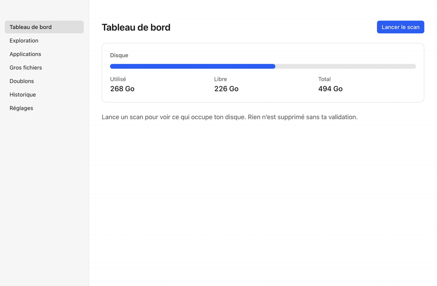
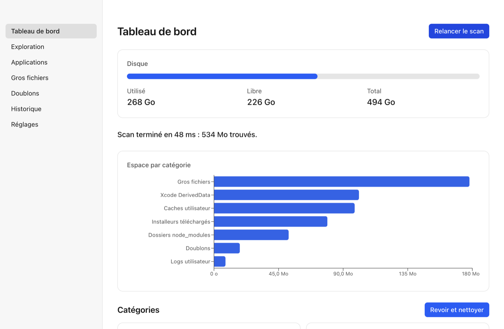
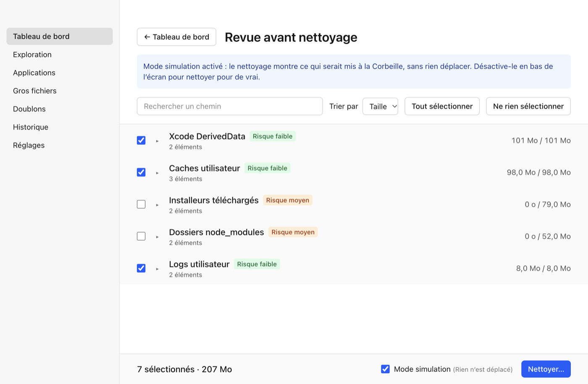
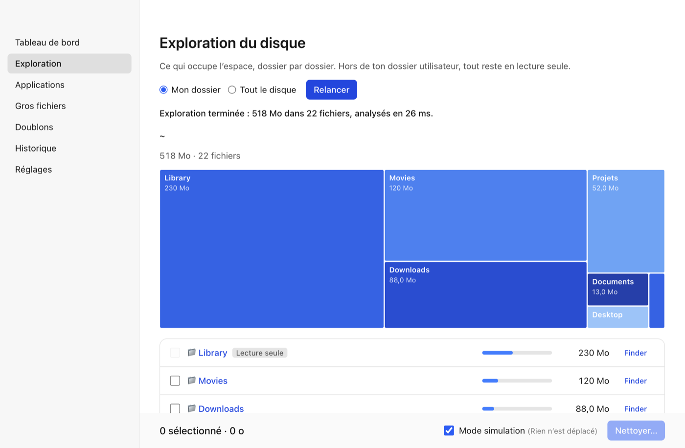
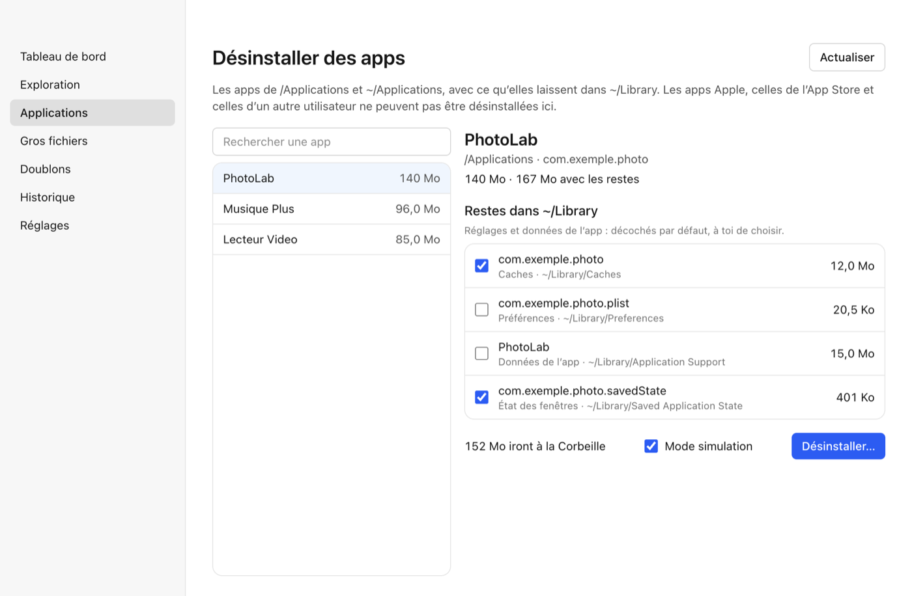
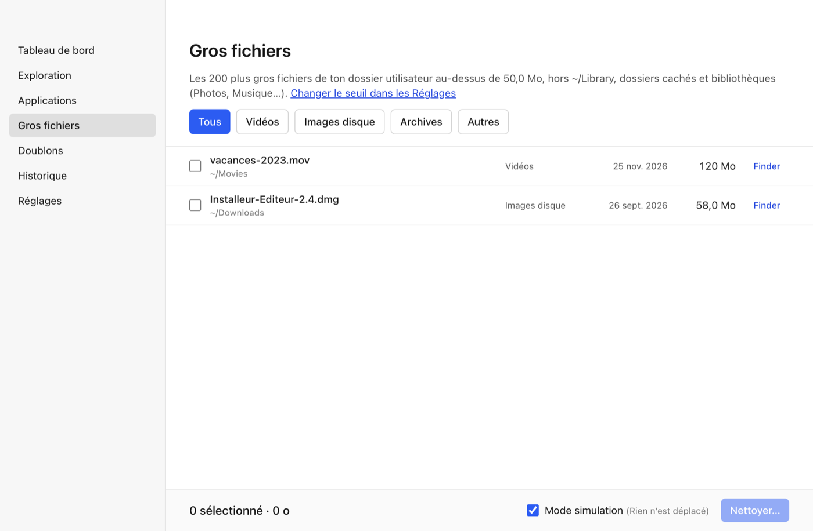
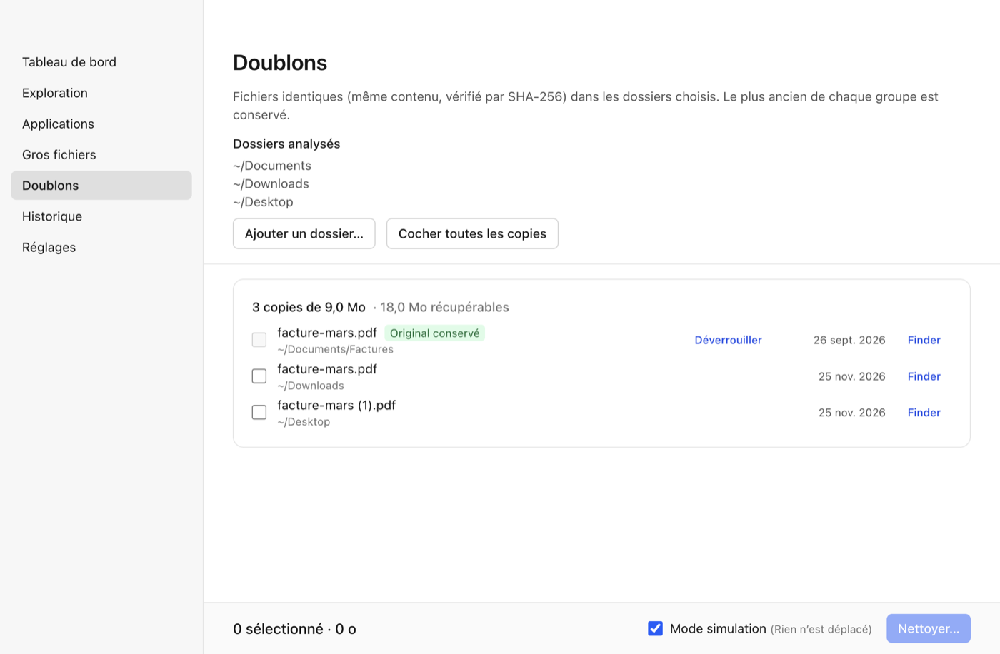
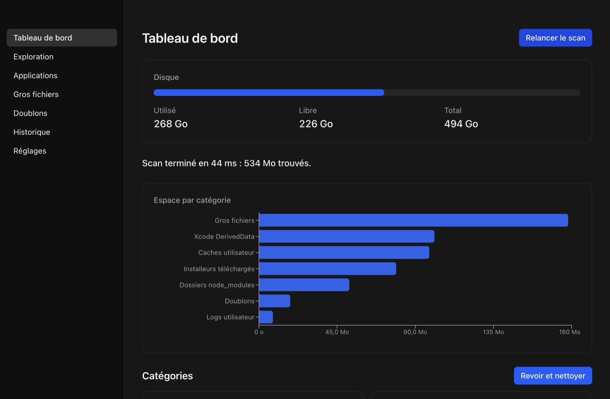
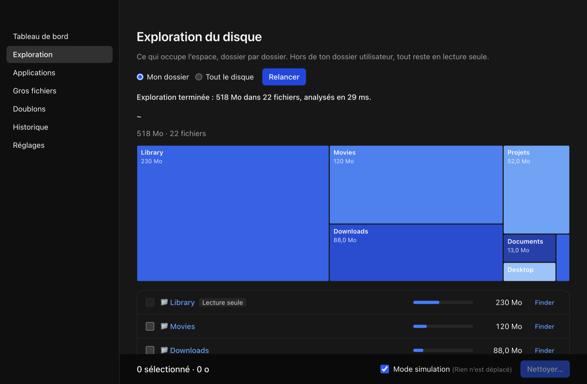
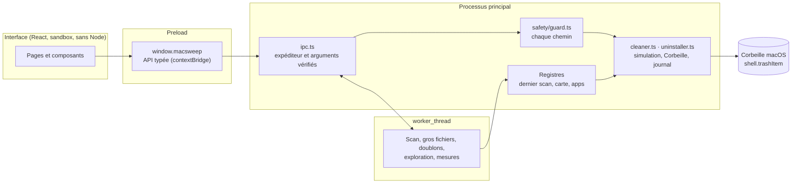

<p align="center">
  
</p>

<h1 align="center">MacSweep</h1>

<p align="center">
  Nettoyeur de Mac local et prudent : il scanne le disque, montre ce qui prend de la place<br />
  et met les fichiers encombrants à la Corbeille, jamais en suppression directe.
</p>

<p align="center">
  
  
  
  
  
</p>

<p align="center">
  
</p>

Aucun compte, aucune requête réseau, aucune télémétrie. Tout se passe sur ton Mac, sans `sudo`, et le **mode simulation** est activé au premier lancement : rien ne bouge tant que tu ne l'as pas décidé.

## Sommaire

- [Fonctionnalités](#fonctionnalités)
- [Sécurité](#sécurité)
- [Captures](#captures)
- [Installer](#installer)
- [Utiliser](#utiliser)
- [Développer](#développer)
- [Architecture](#architecture)
- [Limites connues](#limites-connues)

## Fonctionnalités

| Écran               | Ce qu'il fait                                                                                                                 |
| ------------------- | ----------------------------------------------------------------------------------------------------------------------------- |
| **Tableau de bord** | Espace disque utilisé et libre, scan par catégories avec graphique, niveau de risque de chaque catégorie.                     |
| **Revue**           | Liste virtualisée (plus de 100 000 éléments) avec recherche, tri, sélection par catégorie ou par élément, et total en direct. |
| **Exploration**     | Carte (treemap) de `~` ou de tout le disque, navigable dossier par dossier. En lecture seule hors du dossier utilisateur.     |
| **Applications**    | Désinstalle une app de `/Applications` ou `~/Applications` avec ce qu'elle laisse dans `~/Library`.                           |
| **Gros fichiers**   | Les 200 plus gros fichiers de `~` au-dessus d'un seuil réglable, filtrables par type (vidéos, images disque, archives).       |
| **Doublons**        | Fichiers identiques (taille, puis 64 premiers Ko, puis SHA-256), l'original le plus ancien toujours conservé.                 |
| **Historique**      | Les nettoyages réels, avec l'espace libéré. Chaque déplacement est aussi noté dans un journal JSONL.                          |
| **Réglages**        | Seuils, âges minimaux, dossiers de projets et de doublons, exclusions, mode simulation.                                       |

Catégories analysées : caches utilisateur et des navigateurs, journaux, Xcode (DerivedData, Archives, caches, simulateurs iOS, support des appareils), mises à jour et sauvegardes iPhone/iPad, caches npm/yarn/pnpm, Homebrew, Gradle/Maven, pip/cargo/go, vieux `node_modules`, pièces jointes Mail, installeurs téléchargés, image disque Docker (pour information) et Corbeille.

## Sécurité

La sécurité passe avant l'espace libéré : en cas de doute, MacSweep ne touche pas au fichier. Les règles sont appliquées dans le processus principal, jamais seulement dans l'interface.

- **Corbeille uniquement** : tout part avec `shell.trashItem` et peut être remis en place depuis le Finder. `fs.rm`, `unlink` et `rimraf` sont interdits par ESLint. Seul « Vider la Corbeille » supprime pour de bon, après avoir tapé `VIDER`.
- **Une garde pour chaque chemin** : [`src/main/safety/guard.ts`](src/main/safety/guard.ts) vérifie chaque chemin reçu par IPC avant toute action, même si l'interface l'a déjà filtré. Elle refuse :
  - ce qui est hors du dossier utilisateur ;
  - la liste noire (`/System`, `/Library`, Trousseaux, Mail, Messages, Photos, iCloud, `.ssh`…) ;
  - les dépôts git ;
  - les liens qui sortent du dossier utilisateur.
- **Seulement ce que MacSweep a trouvé** : un chemin absent du dernier scan est refusé, même dans une requête forgée depuis la page.
- **Confirmations** : Documents, Bureau et Images demandent une case en plus, tout comme les catégories à risque élevé. Pour un doublon, la dernière copie est toujours gardée.
- **Apps ouvertes** : rien n'est nettoyé dans les données d'une app en cours d'exécution, vérifié avec `lsappinfo` au scan puis juste avant la Corbeille.
- **Désinstallation encadrée** : seulement tes propres apps, ni Apple ni App Store, et après avoir tapé leur nom.
- **Electron verrouillé** :
  - `contextIsolation`, `sandbox`, aucun `nodeIntegration` ;
  - CSP stricte, et toute requête réseau bloquée par la session ;
  - fuses durcis : pas de `RunAsNode`, intégrité de l'archive `asar` vérifiée ;
  - une API typée exposée par `contextBridge`, dont chaque argument est validé.
- **Accès disque hors de l'interface** : les parcours tournent dans un `worker_thread`, annulables à tout moment.

Le détail de chaque choix est dans [docs/DECISIONS.md](docs/DECISIONS.md) (D1 à D51), la spécification de départ dans [docs/PRD.md](docs/PRD.md).

## Captures

| Tableau de bord                                                   | Revue avant nettoyage                                       |
| ----------------------------------------------------------------- | ----------------------------------------------------------- |
|                      |                             |
| **Exploration du disque**                                         | **Désinstallation d'une app**                               |
|                            |                        |
| **Gros fichiers**                                                 | **Doublons**                                                |
|                      |                      |
| **Mode sombre**                                                   |                                                             |
|  |  |

Les captures et la démo viennent d'un faux dossier utilisateur créé dans le dossier temporaire, en mode simulation.

## Installer

Prérequis : un Mac Apple Silicon sous macOS 13 ou plus récent.

```bash
git clone https://github.com/Chakib-Selhi/MacSweep.git
cd MacSweep
npm install
npm run make
```

1. Ouvre `out/make/dmg/arm64/MacSweep-1.0.0-arm64.dmg`.
2. Glisse **MacSweep** dans **Applications**, puis lance-le.
3. Sur le tableau de bord, clique sur **Ouvrir les Réglages Système** dans le bandeau pour donner l'**Accès complet au disque** à MacSweep, puis relance l'app. Sans cet accès, MacSweep fonctionne, mais ne voit pas Mail, Safari, Messages ni les conteneurs d'apps.

L'app est signée **en ad hoc** (vérifié par `codesign --verify --deep --strict`), sans compte Apple Developer, et n'est pas notariée. Si macOS refuse une copie téléchargée, fais clic droit sur l'app, puis « Ouvrir », ou lance :

```bash
xattr -dr com.apple.quarantine /Applications/MacSweep.app
```

Après chaque nouvelle compilation, la signature change : macOS peut redemander l'Accès complet au disque.

## Utiliser

1. **Scanner** : sur le tableau de bord, « Lancer le scan ». Les catégories apparaissent triées par taille, avec leur niveau de risque.
2. **Revoir** : « Revoir et nettoyer » liste chaque élément. Les catégories à faible risque sont cochées par défaut ; tout le reste est à cocher soi-même.
3. **Simuler** : « Nettoyer… » montre ce qui serait mis à la Corbeille. Tant que le mode simulation est coché, rien n'est déplacé.
4. **Nettoyer pour de vrai** : décoche « Mode simulation » en bas de l'écran, puis relance « Nettoyer… ».
5. **Remettre en place** : dans la Corbeille du Finder, clic droit sur l'élément, puis « Remettre ».

Chaque déplacement est noté dans `~/Library/Application Support/MacSweep/logs/` (date, chemin d'origine, taille), et l'écran Historique résume les nettoyages réels.

<details>
<summary><b>Exploration du disque</b></summary>

- **Mon dossier** explore `~`, **Tout le disque** explore `/` en une minute environ. Les vues en double d'APFS (`/System/Volumes`), `/Volumes` et les montages réseau sont sautés pour ne rien compter deux fois.
- Seuls les éléments de ton dossier utilisateur peuvent aller à la Corbeille depuis la carte, hors `~/Library`, éléments cachés et apps : ceux-là passent par les catégories ou le désinstallateur, qui vérifient les apps ouvertes.
- L'écart entre l'espace utilisé et la carte vient des instantanés APFS, des volumes système, de l'espace purgeable et des dossiers illisibles.

</details>

<details>
<summary><b>Désinstaller une app</b></summary>

- Refusées : les apps Apple (`com.apple.*`), celles de l'App Store, celles d'un autre utilisateur (installées par un administrateur), les apps ouvertes et les liens.
- Les restes sont cherchés dans `~/Library` par identifiant exact (caches, préférences, conteneurs, état des fenêtres, journaux, agents de connexion…) ou par nom exact de l'app.
- Caches, journaux et états de fenêtres sont cochés par défaut. Préférences et données de l'app restent décochées, au cas où tu réinstallerais.
- Pour confirmer, tape le nom de l'app. L'app part en premier : si macOS la refuse, aucun reste n'est déplacé.

</details>

<details>
<summary><b>Gros fichiers, doublons et réglages</b></summary>

- **Gros fichiers** : seuil de 500 Mo par défaut. `~/Library`, les dossiers cachés et l'intérieur des « paquets » (bibliothèque Photos, apps) sont ignorés, pour ne jamais abîmer un paquet.
- **Doublons** : choisis d'abord les dossiers à comparer. L'original, le plus ancien, est verrouillé jusqu'à ce que tu cliques sur « Déverrouiller ».
- **Exclusions** : un dossier exclu n'est jamais analysé ni nettoyé, même s'il a été trouvé par un scan plus ancien.

</details>

## Développer

```bash
npm install
npm start           # l'app en développement, interface rechargée à chaud
npm run lint        # ESLint + Prettier
npm run test:unit   # Vitest, rapide
npm test            # types + Vitest + Playwright (empaquette l'app d'abord)
npm run make        # .dmg et .zip signés en ad hoc dans out/make/
```

Pendant le développement, essaie l'app sur un faux dossier utilisateur : la variable `MACSWEEP_TEST_ROOT` remplace `~` par un dossier du dossier temporaire. « Tout le disque » et `/Applications` deviennent alors son dossier parent. La variable est ignorée dans l'app installée.

```bash
mkdir -p "$TMPDIR/macsweep-essai/home/Library/Caches/demo"
MACSWEEP_TEST_ROOT="$TMPDIR/macsweep-essai/home" npm start
```

Les tests ne touchent jamais au vrai dossier utilisateur.

- Chaque test crée ses fichiers sous `os.tmpdir()`.
- Les tests de bout en bout lancent l'app compilée sur un faux dossier utilisateur et une Corbeille de test.
- Ils ont aussi leur propre dossier de réglages, pour ne pas gêner une instance ouverte.

Deux points restent à vérifier à la main, parce qu'ils touchent la vraie Corbeille et les Réglages Système :

1. **Remettre en place** : sans le mode simulation, nettoie un petit cache, puis fais « Remettre » depuis la Corbeille du Finder.
2. **Accès complet au disque** : donne l'accès depuis le bandeau, relance l'app, et vérifie que le bandeau a disparu.

## Architecture



```
src/main/        processus principal : fenêtre, protocole app://, IPC, nettoyage
  safety/        guard.ts (règles de sécurité) et root.ts (racine de test)
  scanner/       catégories, parcours, exploration et mesures dans un worker_thread
src/preload/     pont contextBridge, API typée window.macsweep
src/renderer/    interface React + Tailwind, sans aucun accès à Node
src/shared/      types et catégories partagés
tests/unit/      Vitest (garde, scanner, nettoyeur, désinstallateur…)
tests/e2e/       Playwright pour Electron, sur un faux dossier utilisateur
docs/            PRD, décisions, images du README
assets/          icône (SVG source et .icns)
```

Pile technique :

- Electron Forge avec Vite et TypeScript strict ;
- React 18, Tailwind, `@tanstack/react-virtual`, Recharts ;
- `electron-store` pour les réglages et l'historique ;
- Vitest et Playwright pour les tests, ESLint et Prettier pour le style.

## Limites connues

- **Apple Silicon et macOS 13 ou plus récent seulement.** L'app n'est pas notariée, faute de compte Apple Developer.
- **Copies APFS** : MacSweep ne détecte pas les clones APFS. L'espace récupérable des doublons peut donc être surestimé.
- **Agents de connexion** : un agent désinstallé n'est pas arrêté sur-le-champ, mais au prochain démarrage de session.
- **Accès complet au disque** : sans lui, les dossiers protégés sont seulement comptés comme illisibles.
